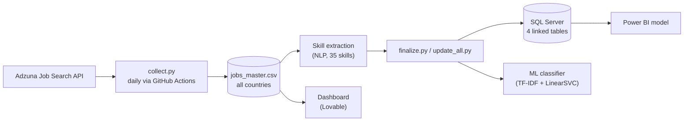

# AI Job Market Intelligence Platform

[](https://github.com/eslam-zayed-eg/-AI-Job-Market-Intelligence-Platform/actions/workflows/collect.yml)

An end-to-end data project that **collects job postings automatically every day**, cleans them, extracts the skills employers ask for, stores everything in a relational SQL database, visualizes it in a dashboard, and trains a machine learning model that predicts a posting's job family from its text. Built as a graduation project (DEPI).

---

## The problem

Students and job seekers rarely know, with evidence, which skills the market actually rewards; career advice is often anecdotal. This project replaces guesswork with measured data from real, continuously growing job postings:

- **Students** see which skills are in demand before choosing a specialization.
- **Job seekers** find real postings that best match the skills they already have.
- **Companies** see how skill demand and salary differ across roles.

## Architecture



## Results snapshot

<!-- STATS:START -->
_Run `python src/finalize.py` to generate this block._
<!-- STATS:END -->

---

## How it was built

### 1. Setup and data source
The data comes from the [Adzuna Job Search API](https://developer.adzuna.com/). The API credentials live in a local `.env` file (never committed; excluded by `.gitignore`) and in GitHub Secrets for the automated workflow. The project started as a small experiment: a single request for "data analyst" jobs to confirm the API worked and to inspect what a posting contains (title, company, location, salary range, contract type, category, a description snippet, a link to the original ad).

### 2. From a first test to a production collector
The collection code evolved in three steps:

1. **Notebook prototype** — one keyword, one page, results flattened into a table.
2. **Multi-keyword collector** — 10 job families with pagination and retry logic for temporary API errors (HTTP 503). The first full run produced 600 postings (580 unique); widening to 7 pages per keyword produced about 1,350 unique postings.
3. **`src/collect.py`** — the production version used today:
   - 4 countries × 16 job families, 50 postings per request
   - **resumes where the previous run stopped** (`data/collection_state.json`), so every run covers new ground
   - **quota-aware**: a per-run request budget (default 80) stays inside Adzuna's usage limits
   - **resilient**: retries temporary errors; stops cleanly on rate limits or bad credentials; a circuit breaker ends the run if the API keeps failing and rewinds so nothing is skipped
   - **incremental**: new postings are added; postings seen again only get a fresh `last_seen`; every posting keeps `first_seen`, `country`, and `currency`

### 3. Cleaning and deduplication
Raw responses are flattened into one row per posting. The same job often appears under several search keywords, so postings are deduplicated on `country + job_id`. A second kind of duplicate matters for analysis: the same advert posted in many cities (for example a training-scheme ad with a fixed salary). Those are counted once in the statistics and in the model so they cannot distort averages or inflate accuracy.

### 4. Skill extraction (NLP)
A curated list of 35 technical skills (Python, SQL, AWS, Azure, Power BI, Machine Learning, Kubernetes, ...) is matched against each description with word-boundary regular expressions, producing a `skills` column for every posting. An early version also tracked the single letter "R", which produced false matches and was removed.

### 5. Relational database
Instead of one flat table, `update_all.py` normalizes the data into four linked SQL Server tables in the `JobMarketDB` database:

| Table | Content |
|---|---|
| `companies` | one row per employer |
| `skills` | the master skill list |
| `jobs_normalized` | one row per posting, linked to `companies` by `company_id` |
| `job_skills` | many-to-many link between postings and skills |

The tables are rebuilt from the master dataset in one command, so the database never drifts from the data.

### 6. Power BI model
Power BI Desktop connects to `JobMarketDB` (Import mode) with three relationships: `companies → jobs_normalized` (`company_id`), `skills → job_skills` (`skill_id`), and `jobs_normalized → job_skills` (`job_id`), all one-to-many.

### 7. Dashboard and Job Matcher
A web dashboard was built with Lovable on top of `data/processed/jobs_for_dashboard.csv`, computing everything live from the real data (no mock data). It covers skill demand, salary analysis, job families, contract types, hiring companies and locations, a searchable job table, and CSV upload to refresh the data.

The **Job Matcher** turns the analysis into an action: the user enters the skills they have, every posting is scored, and the best fits are listed with a link to apply. The score balances two views:

```
coverage     = (user skills found in the job) / (skills the job asks for)
userCoverage = (user skills found in the job) / (skills the user entered)
score        = 0.5 * coverage + 0.5 * userCoverage
```

Using coverage alone would always favour jobs that list a single skill, so both views are combined.

### 8. Machine learning classifier
**Task:** predict which of the 16 job families a posting belongs to, from its description text. The model is a TF-IDF vectorizer (5,000 features, 1–2 word n-grams) with a LinearSVC classifier and balanced class weights.

**Evaluation done carefully:**
- identical reposted adverts are counted once, so they cannot appear in both train and test sets;
- the headline number is a **5-fold cross-validation average with its spread**, not one lucky split;
- the final model is retrained on all data and saved with its metrics (`model_metrics.json`).

**Seven configurations were compared fairly** (5-fold CV on the UK data, measured when the experiment was run):

| | Configuration | Accuracy | Macro-F1 |
|---|---|---:|---:|
| A | baseline: 500 features, Logistic Regression | 72.8% ± 2.4% | 0.716 |
| B | 2,000 features | 73.8% ± 1.6% | 0.726 |
| C | 2,000 features, balanced classes | 75.3% ± 2.1% | 0.744 |
| D | 5,000 features, LR, balanced, sublinear TF | 76.2% ± 1.9% | 0.751 |
| **E** | **5,000 features, LinearSVC, balanced, sublinear TF (used)** | **76.3% ± 2.1%** | **0.751** |
| F | title + description, 2,000 features, LR | 91.6% ± 1.0% | 0.907 |
| G | title + description, 5,000 features, LinearSVC | 92.8% ± 0.7% | 0.919 |

**Why the title is not used.** Adding the job title lifts accuracy to about 93%, but the title usually contains the very words used to find the job, so it answers an easier question. The main model uses the description only (`--use-title` is available to reproduce the other result). Tuning itself added about 3.5 points.

**Where it struggles.** The classifier is strongest on roles with distinctive vocabulary (Data Architect, Business Analyst, BI Analyst, Cloud Engineer) and weakest where roles overlap heavily (Analytics Engineer, Data Scientist, Frontend and Backend Developer). Per-class scores are stored in `data/processed/model_metrics.json`.

### 9. Scaling up and automation
A GitHub Actions workflow (`.github/workflows/collect.yml`) runs `collect.py` every day at 06:00 UTC and commits the updated dataset, so the data keeps growing without manual work. Because every posting records `first_seen` and `last_seen`, trend analysis (how skill demand changes over time) becomes possible as data accumulates.

---

## Engineering decisions and lessons

| Challenge | What happened | Decision |
|---|---|---|
| Temporary API errors | HTTP 503 responses interrupted collection | Retry with backoff; circuit breaker when the API is down |
| Usage limits | Default limits are 25/minute, 250/day, 1,000/week, 2,500/month | Daily request budget, resumable cursor, 3-second pacing |
| Duplicate postings | One job found under several keywords; one advert posted in many cities | Deduplicate on `country + job_id`; count repeated adverts once for statistics and the model |
| Small samples | A skill's average salary moved by about £15,000 when the data grew from 580 to 1,348 postings | Report salaries only for skills with enough postings, and show the median next to the average |
| Mixed currencies | Multi-country data mixes GBP, USD, CAD, AUD | `country` and `currency` columns; SQL, model and statistics run per country (UK by default); salaries are never averaged across currencies |
| Truncated text | Adzuna returns a description snippet, not the full text | Documented limitation; skill counts are a lower bound |
| Misleading accuracy | A single split and repeated adverts inflated early scores | Cross-validation with spread; repeated adverts removed |
| Easy shortcut | The job title nearly gives away the label | Main model is description-only; the title result is reported as a separate experiment |
| Secrets | API keys must not reach GitHub | `.env` is git-ignored; the workflow reads GitHub Secrets |

---

## Project structure

```
.github/workflows/collect.yml     Daily automated collection
src/
  collect.py                      Incremental, quota-aware collector
  finalize.py                     One command: refresh SQL, model, statistics and this README
  update_all.py                   Rebuild SQL tables and retrain the classifier
  experiment_model.py             Fair comparison of model configurations
  skill_stats.py                  Skill demand and salary-by-skill tables
  job_market_analysis.ipynb       Exploratory analysis notebook
data/
  collection_state.json           Where the collector resumes next run
  processed/
    jobs_master.csv               Full deduplicated dataset (all countries)
    jobs_for_dashboard.csv        Export used by the dashboard
    job_classifier_model.pkl      Trained classifier
    tfidf_vectorizer.pkl          Fitted TF-IDF vectorizer
    model_metrics.json            Latest cross-validated results
    model_experiments.csv         Model comparison results
    project_stats.json            Every number shown in the results snapshot
    skill_stats_<country>.csv     Skill demand and salary tables
docs/                             Project presentation
requirements.txt                  Collector dependencies (used by GitHub Actions)
requirements-analysis.txt         Extra dependencies for SQL, model and notebook
```

`data/raw/` and `data/logs/` are git-ignored. The notebook is the exploratory path: its collection and cleaning sections were superseded by `collect.py`, and re-running them would overwrite `jobs_master.csv` in the old format, so use the scripts instead.

## Getting started

**Prerequisites:** Python 3.10+, an [Adzuna API](https://developer.adzuna.com/) key, and — for the SQL step — Microsoft SQL Server (Express is enough) with the ODBC Driver 17 for SQL Server. Power BI Desktop is optional.

```bash
# 1. Get the code
git clone https://github.com/eslam-zayed-eg/-AI-Job-Market-Intelligence-Platform.git job-market-intelligence
cd job-market-intelligence

# 2. Install dependencies
python -m pip install -r requirements.txt -r requirements-analysis.txt

# 3. Add your credentials to a .env file in the project root
#    ADZUNA_APP_ID=your_app_id
#    ADZUNA_APP_KEY=your_app_key

# 4. Collect data (also runs daily through GitHub Actions)
python src/collect.py

# 5. Create the database once (in SSMS or sqlcmd):  CREATE DATABASE JobMarketDB;
#    Then refresh everything: SQL tables, model, statistics, README snapshot
python src/finalize.py
```

**Useful variations**

```bash
python src/finalize.py --skip-sql        # no SQL Server available
python src/update_all.py --use-title     # classifier with the job title as an extra feature
python src/experiment_model.py           # compare model configurations
python src/skill_stats.py --country us   # skill statistics for another country
```

SQL connection defaults to `localhost\SQLEXPRESS`; set `SQL_SERVER` (or a full `DB_URL`) to use another server.

**Automated collection on GitHub:** add `ADZUNA_APP_ID` and `ADZUNA_APP_KEY` as repository secrets (Settings → Secrets and variables → Actions). The workflow can also be started manually from the Actions tab.

## Data dictionary (`jobs_master.csv`)

| Column | Meaning |
|---|---|
| `uid` | `country_jobid`, unique per posting |
| `job_id` | Adzuna posting id |
| `title`, `company`, `location`, `category` | as published |
| `salary_min`, `salary_max`, `currency` | advertised salary range in the country's local currency |
| `contract_type` | permanent / contract / empty |
| `description` | description **snippet** returned by the API |
| `search_keyword` | the job family whose search found the posting (the classifier's label) |
| `created` | posting date |
| `redirect_url` | link to the original advert |
| `country` | `gb`, `us`, `ca`, `au` |
| `skills` | comma-separated tracked skills found in the description |
| `first_seen`, `last_seen` | first and most recent collection timestamps |

## Limitations

- Adzuna returns a **description snippet**, so many postings mention no tracked skill and skill counts are a lower bound.
- Skills come from keyword matching, not a trained NLP model.
- Salaries are advertised minimums in local currency, and some may be Adzuna estimates (the flag is not stored yet).
- The classifier's label is the search keyword, not a verified job title; neighbouring roles genuinely overlap.
- The SQL database and the model currently use one country (UK) to keep salaries in one currency.

## Future work

- Trend analysis of skill demand as daily collection accumulates (`first_seen` / `last_seen`)
- Fetch full job descriptions from permitted sources
- Train an entity-recognition model for skills
- Separate SQL databases and models for the US, Canada, and Australia
- Salary prediction once enough salaried postings exist

## Data source and responsible use

Data is collected through the Adzuna API within its published usage limits, which the collector enforces by design. The project is intended for personal and academic research; before redistributing the collected data or using it commercially, check Adzuna's current terms of service.
